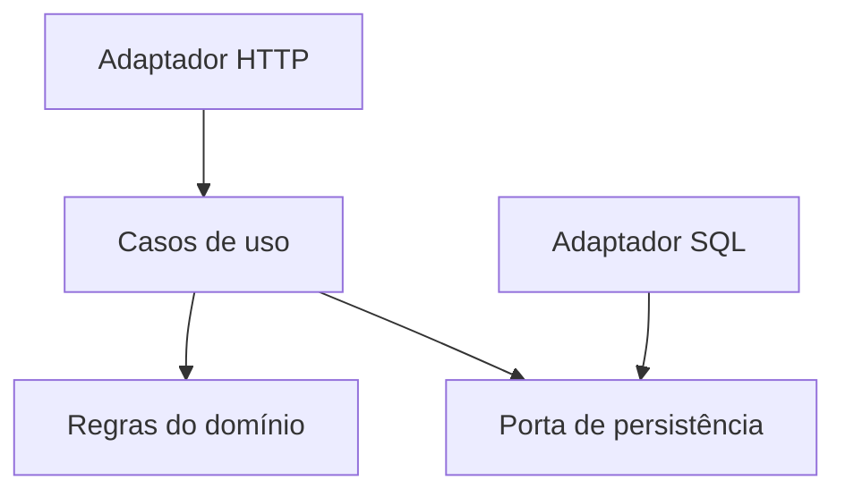

# ARQ-001 — módulos, dependências e decisões

- **Estado:** síntese documental inicial; proposta de estudo, não arquitetura de produção.
- **Revisão:** ChatGPT/Codex, 2026-10-16.
- **Pré-requisitos:** [domínio](../backend/01-dominio-e-invariantes.md) e leitura de dependências de código.
- **Âmbito:** separação de responsabilidades, representação e registo dos motivos.

## Pergunta e fontes

Como permitir alterações compreensíveis sem multiplicar componentes desnecessários?

Consultar [arquitetura-F002 a F004](fontes.md): Cosmic Python cap. 2, C4 de Simon Brown e ADRs de Michael Nygard.

## Compreender

O padrão Repository oferece uma abstração sobre persistência. A inversão de dependências procura evitar que o modelo dependa diretamente dos detalhes de armazenamento: adaptadores implementam o acesso requerido pela aplicação. Isso pode facilitar testes e mudanças, mas introduz código e interfaces que precisam de manutenção. Não exige distribuir a aplicação por máquinas. [F002]

C4 oferece níveis de representação: contexto, contentores, componentes e código. A fonte recomenda desenhar apenas os níveis que acrescentam valor; não é obrigatório produzir os quatro. Um diagrama mostra uma visão da estrutura, não prova que o código respeita os limites. [F003]

Um ADR regista uma decisão significativa com contexto, estado, decisão e consequências. Ao substituir uma decisão, preserva-se o registo anterior e liga-se ao novo. Isso mantém visíveis os motivos que deixam de ser válidos quando o contexto muda. [F004]

## Modelar — proposta própria

Para o exemplo de empréstimos, esta é uma possível direção de dependências de código, não um diagrama de chamadas em execução:

O adaptador SQL concretiza a porta; a configuração da aplicação liga essa implementação ao caso de uso. Pode executar tudo no mesmo processo. O diagrama não define ainda transações, esquema físico ou política de concorrência.

## Comparar

Avaliação própria para orientar estudo:

| Abordagem | Quando considerar | Custo e sinal de revisão |
| --- | --- | --- |
| Código direto com poucas fronteiras | Operação pequena e pouco variável | Rever quando regras se repetirem ou mudanças se espalharem |
| Módulos num mesmo processo | Responsabilidades distintas, implantação conjunta adequada | Exige disciplina nas dependências e acesso aos dados |
| Serviços separados | Necessidade demonstrada de autonomia operacional | Rede, contratos remotos, falhas parciais e operação adicional |

Separar pastas sem controlar imports e acesso aos dados pode manter o mesmo acoplamento. Dividir serviços sem compreender regras pode transformar chamadas locais em dependências remotas difíceis de coordenar.

## Decisão didática, ainda não decisão empresarial

Para estudar o exemplo, propor módulos num processo e interfaces apenas nos pontos que precisam de isolamento. Motivo: investigar responsabilidades sem acrescentar falhas de rede.

Consequências propostas: implantação conjunta e menor complexidade operacional; isolamento de falhas limitado ao processo. Rever se requisitos medidos exigirem implantação, escala ou isolamento independentes.

Esta proposta não obriga projetos futuros a usar o mesmo estilo.

## Construir, testar e rever

Exercícios propostos: desenhar dependências reais, localizar ciclos, simular uma mudança de armazenamento e escrever um ADR com alternativa rejeitada. Comparar o desenho com imports e acessos efetivos.

**Não houve implementação ou testes de arquitetura nesta investigação.** Um desenho e um ADR são documentação; a aderência precisa de evidência no projeto concreto.

Pendências: decomposição por domínio, requisitos de qualidade, métricas de acoplamento e critérios de extração de serviços.
